# SofarLogger user guide

This guide shows you how to read your solar and battery dashboard and how to do the everyday jobs: check what
your system is doing, charge the battery when power is cheap, and keep some battery for later. You don't need
any technical knowledge. Each section has a picture of the screen and step-by-step instructions.

The pictures come from a real system called "Home Solar". Your names and numbers will be different.

## Contents

1. [Opening the dashboard](#1-opening-the-dashboard)
2. [The front page (overview)](#2-the-front-page-overview)
3. ["Can't reach the logger"](#3-cant-reach-the-logger)
4. [Looking at one piece of equipment](#4-looking-at-one-piece-of-equipment)
5. [The battery control page](#5-the-battery-control-page)
6. [Time-of-use: cheap-rate charging and the reserve](#6-time-of-use-cheap-rate-charging-and-the-reserve)
7. [Equipment settings](#7-equipment-settings)
8. [The little screen](#8-the-little-screen)
9. [Common questions](#9-common-questions)
10. [Words used in this guide](#10-words-used-in-this-guide)

---

## 1. Opening the dashboard

The logger is a small computer (a Raspberry Pi) on your home network. You look at it with the web browser on
your phone, tablet or computer.

1. Make sure your phone or computer is on your **home Wi-Fi**.
2. Open the web browser and type the logger's address, for example `http://192.168.1.20`. The person who set
   up your system will give you the address.
3. **Save it:** bookmark the page, or on a phone choose **Add to Home screen** so it opens like an app.

Pages that change settings (Admin, Battery control, Time-of-use) ask for a **username and password**. The
username is `admin`. Keep the password private.

> **Tip:** the pages update themselves every 30 seconds. You don't need to keep pressing refresh.

---

## 2. The front page (overview)

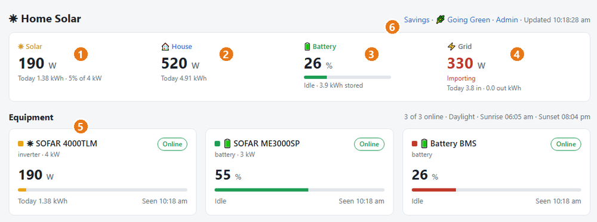

The top box shows your whole system at a glance:

| | What it shows |
|---|---|
| **① Solar** | How much power your solar panels are making **right now**. Underneath: how much they've made **today** (in kWh) and how hard they're working compared with the system's size. |
| **② House** | How much power your home is using right now, and how much it has used today. |
| **③ Battery** | How full the battery is (%). The bar turns **red at 20% or below**. Underneath: whether it's **charging**, **supplying** the house or **idle**, and how much energy is stored. If you see **"% est"**, the figure is the inverter's own guess because the battery's BMS isn't answering: treat it with care. |
| **④ Grid** | Your connection to the power company. **Red "Importing"** means you're buying power. **Green "Exporting"** means you're selling spare solar. "Not using the grid" means the house is running on solar and battery. |
| **⑤ Equipment** | One card per device: solar inverter, battery inverter, battery. The badge shows **Online** (working), **Offline · night** (solar inverters sleep at night, which is normal), or a problem such as **No data**. **Tap a card** to see its details. |
| **⑥ Links** | **Savings** (money saved), **Going Green** (carbon saved) and **Admin** (settings). "Updated" shows the time of the last refresh. |

Further down the page are charts:

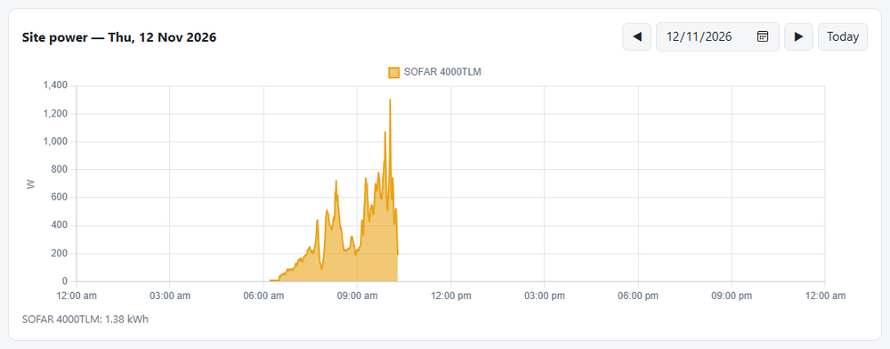

- **Site power:** solar power through the day. Use **◀ ▶** to look at other days, or **Today** to come back.
- **Daily energy:** one bar per day. Choose **7 days, 30 days, 90 days or 1 year**.
- **Monthly energy:** every month since the system started.
- **Export CSV:** download the readings for a spreadsheet.

**On a phone** the same boxes stack two by two:

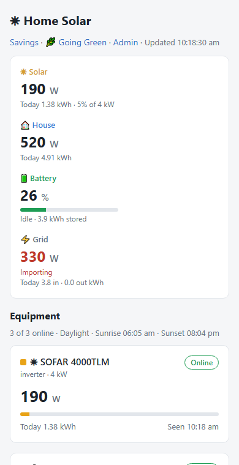

---

## 3. "Can't reach the logger"

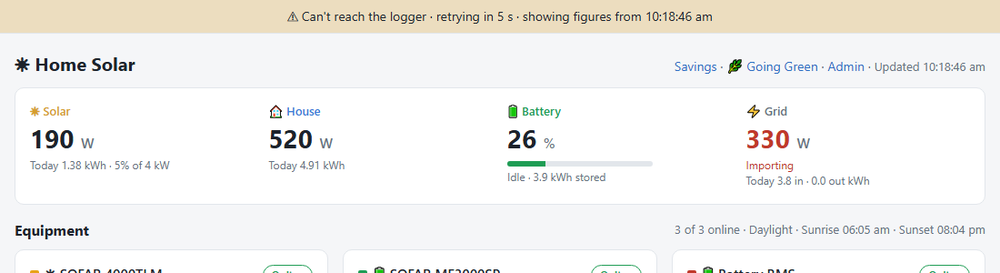

If your phone loses its connection to the logger, for example when it wakes up, changes Wi-Fi, or you leave
home, a yellow bar appears at the top. The page **keeps showing the last figures** (the bar tells you what
time they're from) and **tries again by itself**. When the connection is back, the bar turns green, says
**✓ Reconnected** and disappears.

If the bar doesn't go away:

1. Check your phone is on your **home Wi-Fi** (not mobile data).
2. Check the logger has power: its small lights should be on.
3. Wait a couple of minutes: after a power cut the logger takes a minute or two to start.
4. Still nothing? Turn the logger off and on again at the wall, wait 2 minutes, and reload the page.

---

## 4. Looking at one piece of equipment

Tap a card on the front page to open that device's own page. This is the battery inverter's:

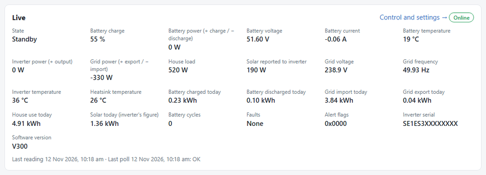

The **Live** box shows everything the device reports. The most useful figures:

| Figure | Meaning |
|---|---|
| **State** | What the inverter is doing: *Charging*, *Discharging* (supplying the house), *Standby* (resting) |
| **Battery power** | **+** means charging, **−** means discharging |
| **Grid power** | **+** means exporting (selling), **−** means importing (buying) |
| **House load** | What the house is using now |
| **Faults** | Should say *None* |

Below the Live box are the same charts as the front page, for this device only, and a list of **Events**
(faults and changes). The **Control and settings →** link opens the battery control page (next section).

---

## 5. The battery control page

Open it from the battery inverter's page (**Control and settings →**) or from **Admin → Equipment**. It asks
for the admin password.

### "Now": what the battery is doing

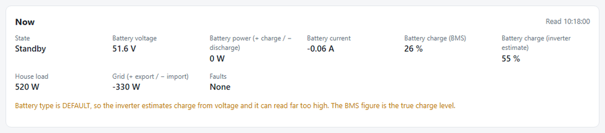

The same live figures, plus **two battery percentages**:

- **Battery charge (BMS):** from the battery's own management system. **This is the true figure.**
- **Battery charge (inverter estimate):** the inverter's guess from the battery voltage. It can be well out:
  ignore it if the two disagree.

### "Who controls the battery"

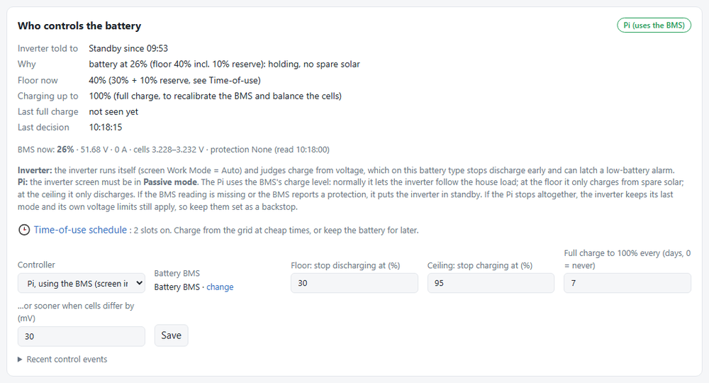

Your battery can be run in one of two ways:

| Controller | What happens |
|---|---|
| **Inverter** | The inverter runs the battery by itself, using its own (less accurate) battery estimate. |
| **Pi** | The logger runs the battery using the BMS's true charge level, your **floor** and **ceiling**, and your **time-of-use schedule**. |

When the Pi is in control, the box tells you:

- **Inverter told to:** what the Pi last asked for (*Auto* = follow the house, *Standby* = rest, or *Charge
  from the grid*).
- **Why:** the reason in plain words, for example *"battery at 26% (floor 40% incl. 10% reserve): holding, no
  spare solar"*.
- **Floor now:** the lowest the battery is allowed to go at the moment.
- **Charging up to:** the highest it will charge to (100% about once a week, to keep the cells balanced).

**The settings:**

| Setting | Meaning | Typical |
|---|---|---|
| **Floor** | The battery stops supplying the house at this level, and only charges from spare solar below it | 20–30% |
| **Ceiling** | The battery stops charging at this level | 95% |
| **Full charge every … days** | A charge to 100% now and then, so the battery can balance its cells | 7 |
| **…or sooner when cells differ by** | Charge to 100% sooner if the cells drift apart | 30 mV |

#### How to: hand the battery to the Pi

1. On the **inverter's own screen**, go to **Settings → Work Mode Set → Set Passive Mode**. (Without this, the
   inverter refuses the Pi's commands.)
2. On the battery control page, under **Controller**, choose **Pi, using the BMS**.
3. Check the **Floor** and **Ceiling**, then press **Save** and confirm.
4. Within a minute, **Inverter told to** and **Why** fill in. Watch it for a few minutes the first time.

#### How to: give control back to the inverter

1. Under **Controller**, choose **Inverter**, press **Save** and confirm.
2. On the **inverter's screen**, set **Work Mode** back to **Auto**. (Don't skip this: otherwise the inverter
   stays in Passive mode with nobody running it.)

#### How to: change the floor or ceiling

1. Type the new numbers in **Floor** and/or **Ceiling**.
2. Press **Save**. The Pi uses them within a minute.

### Manual control: do something right now

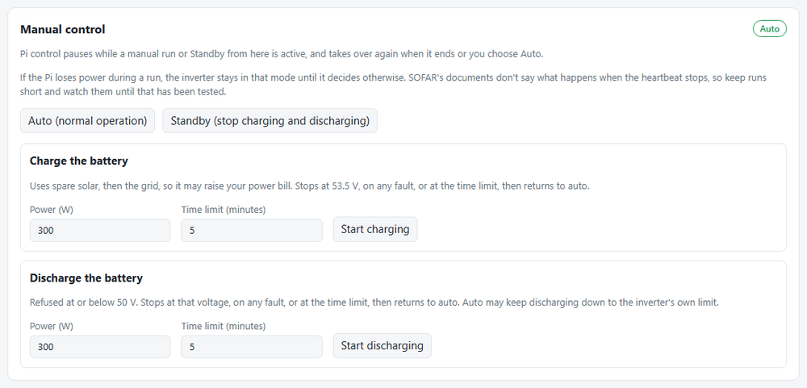

| Button | What it does |
|---|---|
| **Auto (normal operation)** | Back to normal. Also cancels any of the options below. |
| **Standby** | The battery stops charging and discharging until you press Auto. |
| **Charge the battery** | Charges at the power you choose for the time you choose. It uses spare solar first and **then the grid**, so it can add to your power bill. |
| **Discharge the battery** | Supplies power from the battery at the power you choose for the time you choose. |

#### How to: charge the battery now for half an hour

1. Under **Charge the battery**, set **Power (W)**, for example `1000`.
2. Set **Time limit (minutes)** to `30`.
3. Press **Start charging** and confirm.
4. It stops by itself after 30 minutes, at the safety voltage, or on any fault, and goes back to normal.

While a manual run is on, the Pi's automatic control waits and then takes over again.

> **Safety:** start with a low power and a short time, and keep an eye on it the first time.

---

## 6. Time-of-use: cheap-rate charging and the reserve

Open it from the battery control page: **🕒 Time-of-use schedule**. It only works while the **Pi** controls the
battery.

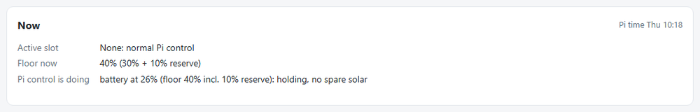

The **Now** box shows the logger's clock, which slot (if any) is running, and the floor in force.

### Slots

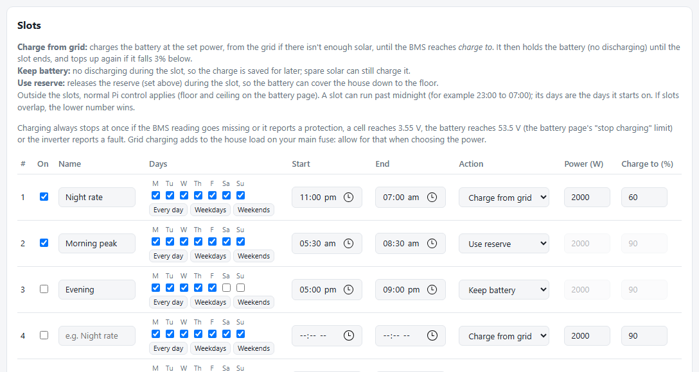

You can have up to **10 slots**. Each one has days, a start and end time, and an action:

| Action | What happens during the slot |
|---|---|
| **Charge from grid** | Charges the battery at the **Power** you set until it reaches **Charge to**, using the grid if there isn't enough sun. Then it rests until the slot ends. |
| **Keep battery** | The battery doesn't supply the house, so its charge is saved for later. Spare solar can still charge it. |
| **Use reserve** | Lets the house use the **reserve** (see below). |

Good to know:

- A slot can **run past midnight**, for example 23:00 to 07:00. Tick the days it **starts** on.
- If two slots overlap, the **lower number wins**.
- Outside the slots, the battery runs normally between your floor and ceiling.

#### How to: charge the battery on the cheap night rate

Say your power is cheap from 11 pm to 7 am:

1. In an empty row, tick **On**.
2. **Name:** `Night rate`.
3. Press **Every day** (or tick just the days you want).
4. **Start** `23:00`, **End** `07:00`.
5. **Action:** *Charge from grid*.
6. **Power (W):** for example `2000`. Remember this adds to everything else in the house on your main fuse.
7. **Charge to (%):** for example `60`, enough for tomorrow's evening, leaving room for solar.
8. Press **Save schedule**.

#### How to: save the battery for the expensive evening

1. In an empty row, tick **On**, and name it `Before peak`.
2. Choose the days, and times such as **14:00** to **17:00**.
3. **Action:** *Keep battery*.
4. Press **Save schedule**. During those hours the battery doesn't supply the house; it fills from the sun
   instead, ready for the evening.

### Reserve: keep some battery for the morning

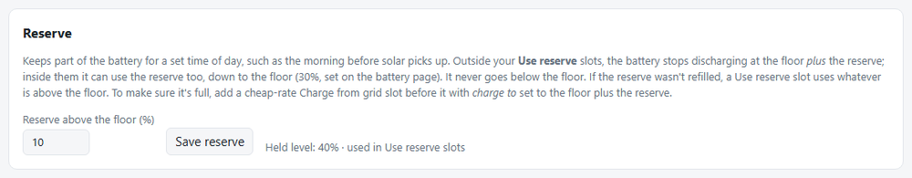

The reserve is a slice of battery that's **kept back** until a time you choose, for example for the morning
before the sun comes up.

**Example:** floor 30%, reserve 10%, and a *Use reserve* slot from 05:30 to 08:30.

| Time | What the battery does |
|---|---|
| Evening | Supplies the house down to **40%** (30% + 10%), then rests |
| Overnight | Rests at 40%. The house runs on the grid |
| 05:30–08:30 | The reserve is released: the battery covers the morning down to **30%** |
| After 08:30 | Rests again, and refills from the sun during the day |

It **never** goes below the floor (30% here). If the reserve wasn't refilled, the morning slot just uses
whatever there is above the floor.

#### How to: set up a morning reserve

1. In the **Reserve** box, type `10` in **Reserve above the floor (%)** and press **Save reserve**.
2. In the **Slots** table, use an empty row: tick **On**, name it `Morning peak`, press **Every day**.
3. **Start** `05:30`, **End** `08:30`, **Action:** *Use reserve*.
4. Press **Save schedule**.
5. **Optional:** to be sure the reserve is full each morning, add a *Charge from grid* slot on the cheap night
   rate with **Charge to** set to the floor plus the reserve (40% in this example).

---

## 7. Equipment settings

**Admin → Equipment** lists every device. You usually set these up once.

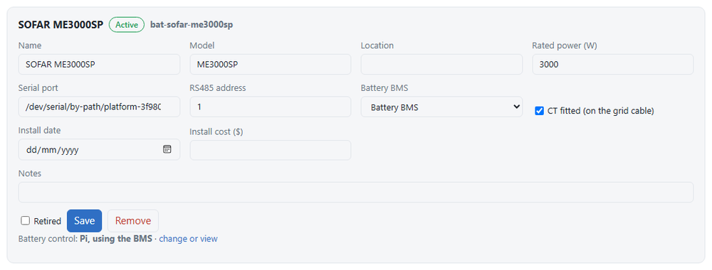

On the **battery inverter** (ME3000SP):

- **Battery BMS:** which battery belongs to this inverter. Each battery belongs to one inverter.
- **CT fitted:** tick this if the inverter's current clamp is on the main grid cable (it normally is).
- **Battery control:** shows who's in control, with a link to change it.

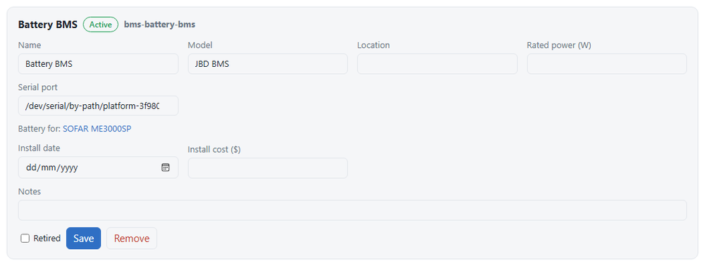

On the **battery BMS**: **Battery for** shows which inverter it's linked to.

Press **Save** after any change. The logger picks it up within a minute.

---

## 8. The little screen

If you have the optional little screen, it shows the same figures without opening a browser. It updates every
15 seconds.

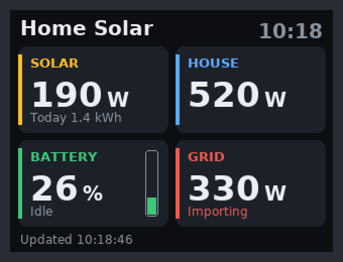

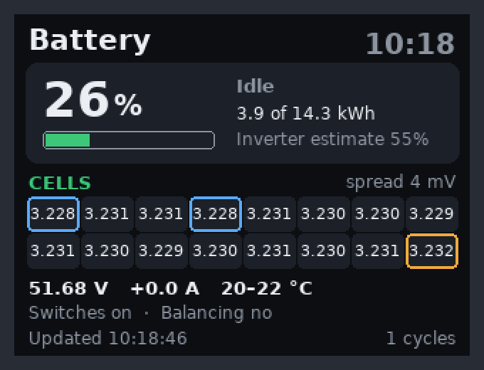

The three buttons on its side:

| Button | What it does |
|---|---|
| **Top (K1)** | Previous page |
| **Middle (K2)** | Turns the picture upside down (if you've mounted it the other way up) |
| **Bottom (K3)** | Next page |

The battery page shows every cell of the battery. The **lowest** cell has a **blue** outline and the
**highest** an **amber** one. A **red** cell is outside its safe range and worth asking about.

---

## 9. Common questions

**The house is using power but the battery isn't helping.**
Look at **Why** on the battery control page. Usually the battery has reached the **floor** (or the floor plus
the **reserve**) and is resting on purpose. It will start again when the sun refills it, or when a *Use
reserve* slot starts.

**The sun is shining but the battery isn't charging.**
Either it has reached the **ceiling**, or the panels are only just covering the house (it needs at least about
50 W spare). It will start when there's more spare solar.

**I'm exporting power but the battery isn't full.**
Check for a slot that's running, and look at **Why**. If the battery is at the ceiling it won't charge more
until the next full charge (shown under **Charging up to**).

**The two battery percentages are different.**
Trust **Battery charge (BMS)**. The inverter's estimate can be a long way out.

**The battery page says "the inverter isn't in Passive mode".**
The Pi is in control but the inverter's screen isn't in Passive mode. Set **Work Mode → Passive Mode** on the
inverter, or switch the controller back to **Inverter**.

**It says "the poller has stopped deciding".**
The logger's background program hasn't checked in for a while. Wait two minutes. If it doesn't clear, turn the
logger off and on at the wall.

**I changed a setting and nothing happened.**
Changes take up to a minute. Charging and discharging also wait at least a minute between switches, so they
don't flicker on cloudy days.

**A card on the front page says "Offline · night".**
Solar inverters switch off when it's dark. That's normal.

---

## 10. Words used in this guide

| Word | Meaning |
|---|---|
| **W / kW** | Power *right now* (1 kW = 1,000 W). Like the speed on a car's speedometer. |
| **kWh** | Energy *over time*. Like the distance on the trip meter. Your power bill counts kWh. |
| **Battery %** | How full the battery is. |
| **BMS** | The battery's own management system. It knows the true charge level and protects the cells. |
| **Inverter** | The box that turns solar or battery power into household power. |
| **CT** | A clamp on the main power cable that lets the inverter see what you're buying or selling. |
| **Import / export** | Buying power from the grid / selling spare power to it. |
| **Floor** | The lowest the battery is allowed to go. |
| **Ceiling** | The highest the battery charges to (except the occasional full charge). |
| **Reserve** | Extra battery kept back above the floor until a *Use reserve* slot. |
| **Time-of-use (TOU)** | Power prices that change through the day. The schedule lets the battery take advantage. |
| **Passive mode** | The inverter setting that lets the logger give it instructions. |

> **Safety reminder:** the logger sends commands to your battery inverter. The battery's own BMS and the
> inverter's limits always stay in charge of safety. If something looks wrong (a fault, a red cell, the
> battery much hotter than usual), switch the controller back to **Inverter**, set the inverter's Work Mode to
> **Auto**, and ask your installer.
